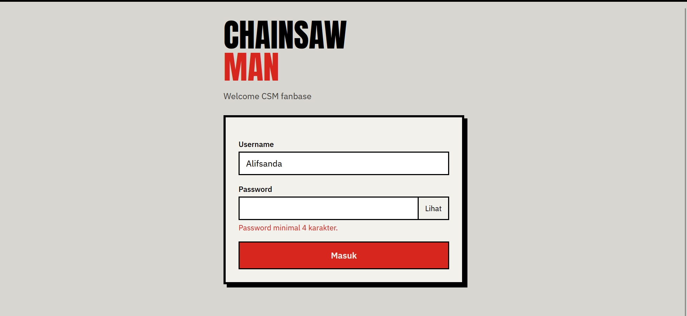
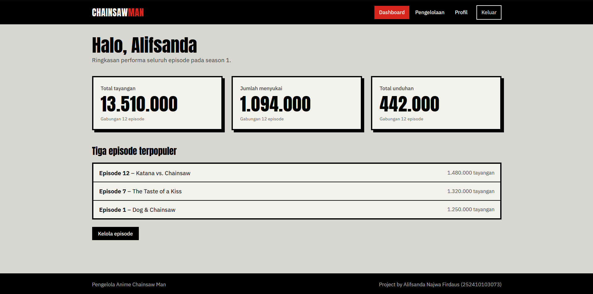
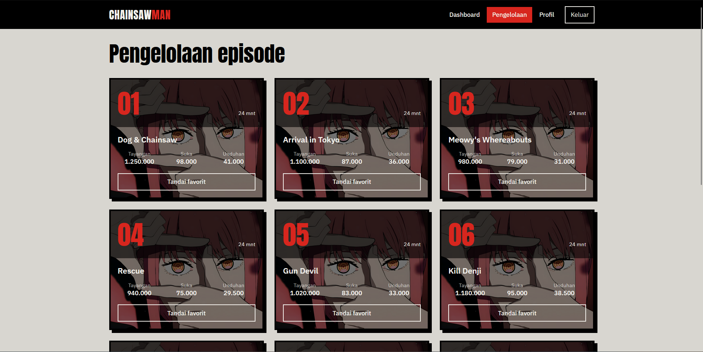
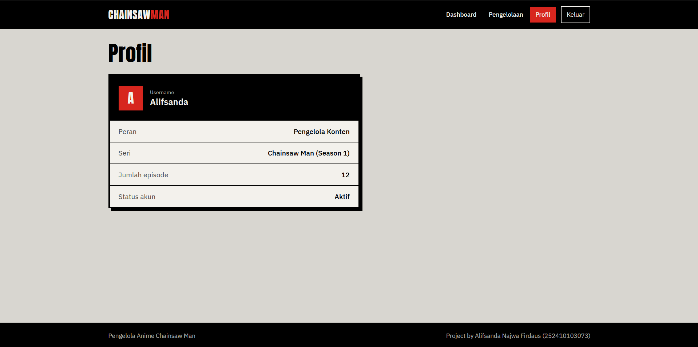

# CSM Management

CSM Management adalah aplikasi web dashboard berbasis Laravel untuk simulasi pengelolaan konten fanbase Chainsaw Man. Aplikasi ini menampilkan fitur login, dashboard performa, halaman pengelolaan episode, dan profil pengguna dengan desain UI yang terinspirasi dari tema anime ChainsawMan.

## Fitur utama

- Login sederhana dengan validasi username dan password
- Dashboard statistik performa episode
- Halaman pengelolaan episode
- Halaman profil pengguna
- Data dummy untuk simulasi tanpa database real
- UI responsif dengan Blade + Tailwind CSS

## Teknologi yang digunakan

- PHP 8.3
- Laravel 13
- Composer
- Vite
- Tailwind CSS
- Blade Templates

## Screenshots









## Struktur proyek

```text
.
├── app/
│   └── Http/
│       └── Controllers/
│           └── PageController.php
├── resources/
│   ├── asset/
│   └── views/
│       ├── dashboard.blade.php
│       ├── login.blade.php
│       ├── pengelolaan.blade.php
│       ├── profile.blade.php
│       └── layouts/
├── routes/
│   └── web.php
├── public/
├── .env.example
├── composer.json
├── package.json
├── artisan
├── vite.config.js
├── phpunit.xml
└── README.md
```

## Cara menjalankan project

1. Clone repository ini
   ```bash
   git clone https://github.com/Firdausizm/UTS_PWEB_252410103073.git
   cd UTS_PWEB_252410103073
   ```

2. Install dependency PHP
   ```bash
   composer install
   ```

3. Copy file environment
   ```bash
   copy .env.example .env
   ```

4. Generate key aplikasi
   ```bash
   php artisan key:generate
   ```

5. Install dependency frontend
   ```bash
   npm install
   ```

6. Build aset frontend
   ```bash
   npm run build
   ```

7. Jalankan server lokal
   ```bash
   php artisan serve
   ```

8. Buka browser dan akses
   ```text
   http://localhost:8000/login
   ```

## Login demo

Aplikasi ini menggunakan simulasi login tanpa autentikasi database. Username minimal 3 karakter dan password minimal 4 karakter. Setelah login, username akan dikirim sebagai query parameter untuk menampilkan data pengguna di halaman dashboard, pengelolaan, dan profil.

Contoh:

```text
/login
/dashboard?username=yourname
/pengelolaan?username=yourname
/profile?username=yourname
```

## Catatan

Project ini cocok digunakan sebagai demo atau tugas pengembangan web sederhana dengan Laravel dan desain custom UI. Untuk kebutuhan produksi, fitur autentikasi dan penyimpanan data sebaiknya diganti dengan database dan sistem auth yang lebih aman.

## Lisensi

Project ini menggunakan lisensi default Laravel/MIT sesuai dengan template aplikasi Laravel yang dipakai.

